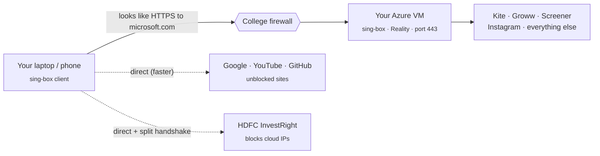

<div align="center">

# reality-tunnel

**Your own private tunnel on Azure, for Wi-Fi that blocks sites and VPNs.**

One script builds the server. Your laptop or phone connects in a minute.


[**Setup**](#setup-step-by-step) •
[Mac](#mac) •
[Windows](#windows) •
[Phone](#android--iphone) •
[Routing](#routing) •
[Cost](#cost) •
[Troubleshooting](#troubleshooting)

</div>

---

## Why this exists

College and office networks often block sites by reading the **site name in the HTTPS
handshake** (SNI filtering), allow only ports 80/443, and recognise commercial VPNs
(WARP, Proton, Nord) and block them too. This repo gives you a tunnel they can't tell
apart from normal web browsing.

| | |
|---|---|
| **Hard to detect** | VLESS + Reality on port 443. The firewall sees what looks like an ordinary visit to `www.microsoft.com`. |
| **Your own IP** | A static IP in the region you choose (for example India), used only by you. Good for brokers like Zerodha that check login IPs. |
| **Split routing** | Unblocked heavy sites (Google, YouTube…) skip the tunnel. Sites that refuse cloud IPs go direct with a split handshake. |
| **Locked down** | Only TCP 443 is open, with no SSH. Keys are generated **on your server** at first boot. |
| **Student-friendly** | Runs on Azure for Students credit. No credit card needed. |

> [!IMPORTANT]
> Running your own VPN is legal in India, but it may break your institution's IT
> acceptable-use policy. That's your call. Never share your link, and don't use this to
> harm anyone.

---

## How it works



---

## Setup, step by step

No credit card and no coding knowledge needed. About **20 minutes** in all.

**Have ready:** your **college email**, a phone that gets SMS, and the device you want to
use (Mac, Windows PC, Android or iPhone).

| Step | What you do | Time |
|---|---|---|
| [1](#step-1-get-a-free-azure-for-students-account) | Get a free Azure for Students account | 5 min, one time |
| [2](#step-2-open-azure-cloud-shell) | Open Azure Cloud Shell | 2 min |
| [3](#step-3-create-your-server) | Create your server | 5 min |
| [4](#step-4-save-your-link) | Save your link | 1 min |
| [5](#step-5-connect-your-device) | Connect your device | 2 to 5 min |
| [6](#step-6-check-it-works) | Check it works | 1 min |

> [!IMPORTANT]
> Do steps 1 to 4 on **mobile data or home Wi-Fi**, where Azure isn't blocked. After that,
> the tunnel works on college Wi-Fi.

### Step 1: Get a free Azure for Students account

You get **USD 100 of credit for 12 months**. This server uses about USD 11 a month, so the
credit lasts the year. Skip this step if you already have Azure for Students.

1. Go to **[azure.microsoft.com/free/students](https://azure.microsoft.com/en-in/free/students/)**
   and click **Start free**.
2. Sign in with a Microsoft account, or click **Create one** (any email works, even Gmail).
3. Fill in the form:
   - **School email address:** your **college email** (for example `name@college.edu.in`)
   - name, country (**India**) and date of birth
   - your phone number, then the SMS code you receive
4. Open the verification email in your **college inbox** and click the link. Check spam if
   it doesn't arrive in 10 minutes. If your college isn't recognised, choose to verify with
   a student ID instead.
5. Accept the agreement and click **Sign up**. You land on the
   [Azure portal](https://portal.azure.com).

> [!NOTE]
> You are never charged. When the credit or the 12 months run out, everything just stops
> until you renew (you can renew each year while you're a student).

### Step 2: Open Azure Cloud Shell

Cloud Shell is a terminal inside your browser with the Azure tools already installed, so
you install nothing.

1. Go to **[shell.azure.com](https://shell.azure.com)** and sign in with the same account.
2. Choose **Bash** (not PowerShell).
3. If you see **Getting started**: pick **No storage account required**, choose the
   **Azure for Students** subscription, then click **Apply**.
4. Wait for a prompt like `yourname@Azure:~$`.

To paste into Cloud Shell: `Ctrl+Shift+V` on Windows, `Cmd+V` on Mac, or right-click →
**Paste**.

### Step 3: Create your server

1. Paste these two commands into Cloud Shell, pressing **Enter** after each:
   ```bash
   git clone https://github.com/prajwal-priyadarshan/reality-tunnel.git && cd reality-tunnel
   ```
   ```bash
   bash azure/deploy.sh
   ```
2. It shows a table of **live prices**, then asks `Create the server now? [y/N]`. Type
   **`y`** and press **Enter**.
3. Wait **3 to 6 minutes** while it works. You'll see lines like:
   ```
   ==> Creating resource group reality-vpn-rg in centralindia
   ==> Creating VM reality-vpn (Standard_B1s)
      Standard_B1s not available here (SkuNotAvailable). Trying the next size…
   ==> Creating VM reality-vpn (Standard_B2ats_v2)
   ==> Opening TCP 443 only (SSH stays closed)
   ```
   "Not available here" is normal: the script just tries the next size.
4. At the end it prints **your link**:
   ```
   Your connection link (treat it like a password):
   vless://1b2c3d4e-....@20.x.x.x:443?security=reality&sni=www.microsoft.com&...
   ```

<details>
<summary><b>What the script created in your Azure account</b></summary>

| Created | Why |
|---|---|
| Resource group `reality-vpn-rg` | A folder for everything below, so it's easy to delete later |
| Ubuntu 24.04 VM `reality-vpn` | Your server, in Pune (Central India) if your account allows it |
| Static public IP | The address your devices connect to |
| 30 GB disk | The server's drive |
| Network rule for port 443 | The only open port. SSH and everything else stay closed |

On first boot the server installed **sing-box**, made **new private keys** that only your
server knows, and wrote your link.
</details>

#### If India isn't allowed on your account

Microsoft gives each student subscription its own list of allowed regions, and some
accounts get **no Indian region**. The script then picks the closest allowed one by itself
(Dubai `uaenorth` first, then Malaysia, Hong Kong and so on) and tells you:
```
==> India regions aren't allowed on this subscription (allowed: austriaeast eastasia
    koreacentral malaysiawest uaenorth ). Using uaenorth, the closest.
```
This is fine: your exit IP is then in that country instead of India, and pages may be a
little slower. To choose a region yourself:
```bash
LOCATION=malaysiawest bash azure/deploy.sh
```

#### If the script stops with an error

It prints Azure's error and saves the full log to `~/reality-deploy-error.log`. Running
`bash azure/deploy.sh` again carries on where it stopped. If it still fails, create the
server by hand, one command at a time:

<details>
<summary><b>Create the server by hand (5 commands)</b></summary>

1. Check whether a VM was created anyway. If this prints a table with `reality-vpn`, skip
   to command 4.
   ```bash
   az vm list -g reality-vpn-rg -o table
   ```
2. Prepare the first-boot setup file. It prints nothing, which means it worked
   (`ls -l ~/ci.sh` shows the file).
   ```bash
   cd ~/reality-tunnel && sed 's/__COVER__/www.microsoft.com/' server/cloud-init.sh > ~/ci.sh
   ```
3. Create the VM (2 to 4 minutes). Replace `uaenorth` with your region. Success prints a
   block that includes `"powerState": "VM running"`. If it shows `SkuNotAvailable`, try
   `--size Standard_B2als_v2` or `--size Standard_B1s`.
   ```bash
   az vm create -g reality-vpn-rg -n reality-vpn -l uaenorth --image Ubuntu2404 --size Standard_B2ats_v2 --admin-username azureuser --generate-ssh-keys --public-ip-sku Standard --nsg-rule NONE --os-disk-size-gb 30 --storage-sku StandardSSD_LRS --custom-data ~/ci.sh
   ```
4. Open port 443. It prints a long block; look for `"name": "open-port-443"` and
   `"provisioningState": "Succeeded"`.
   ```bash
   az vm open-port -g reality-vpn-rg -n reality-vpn --port 443 --priority 100
   ```
5. Wait **3 minutes**, then get your link. If it prints nothing, wait 2 more minutes and
   run it again.
   ```bash
   az vm run-command invoke -g reality-vpn-rg -n reality-vpn --command-id RunShellScript --scripts 'cat /root/vless_link.txt' --query 'value[0].message' -o tsv
   ```
</details>

> [!NOTE]
> If Cloud Shell shows a yellow *"not registered to Microsoft.CloudShell Namespace"*
> message, it's only a warning. To clear it, run
> `az provider register -n Microsoft.CloudShell` once.

### Step 4: Save your link

The link is the **only thing** your devices need. Anyone who has it can use your server,
so treat it like a password.

1. Select the whole `vless://…` line (it's one long line) and copy it.
2. Save it somewhere private, such as your phone's notes or a message to yourself.

> [!WARNING]
> **Lost it, or closed Cloud Shell too early?** Open Cloud Shell again and run:
> ```bash
> az vm run-command invoke -g reality-vpn-rg -n reality-vpn --command-id RunShellScript --scripts 'cat /root/vless_link.txt' --query 'value[0].message' -o tsv
> ```

### Step 5: Connect your device

The same link works on several devices.

| Device | Easiest way | Full setup (all routing fixes) |
|---|---|---|
| **Android / iPhone** | Install **Hiddify** → copy your link → tap **+** → **Add from clipboard** → tap connect | [Phone section](#android--iphone) |
| **Windows 10/11** | Install [Hiddify](https://github.com/hiddify/hiddify-app/releases) → **+** → **Add from clipboard** → connect | [Windows section](#windows) |
| **Mac** | Follow the [Mac section](#mac) (3 commands) | [Mac section](#mac) |

### Step 6: Check it works

With the tunnel on:

1. Open **[ipinfo.io](https://ipinfo.io)**. It should show **Microsoft Corporation** and
   **Pune** (or your server's region).
2. Open the sites that were blocked before. They should load.

---

## Mac

Everything below runs in the **Terminal** app: press `Cmd+Space`, type *Terminal*, press
**Enter**.

### First time (about 5 minutes)

**1. Install Homebrew.** Skip this if `brew --version` already prints a version.
```bash
/bin/bash -c "$(curl -fsSL https://raw.githubusercontent.com/Homebrew/install/HEAD/install.sh)"
```
It asks for your Mac password (see the note below). At the end it prints **Next steps**
with 2 or 3 commands starting with `echo` and `eval`: copy and run those too.

**2. Install sing-box:**
```bash
brew install sing-box
```

**3. Download this repo:**
```bash
git clone https://github.com/prajwal-priyadarshan/reality-tunnel.git ~/reality-tunnel && cd ~/reality-tunnel
```

**4. Make your configs.** Paste your own link between the single quotes:
```bash
python3 client/make_client_config.py 'vless://PASTE-YOUR-LINK-HERE'
```
It should print `wrote …/config-proxy.json` and `wrote …/config-tun.json`. They go in
`client/out/`, which git ignores, so your keys never get uploaded.

**5. Connect:**
```bash
bash client/connect.sh tun
```
You should see `Connecting (tun mode). Ctrl+C to stop.` **Keep this window open.** Closing
it, or pressing `Ctrl+C`, disconnects.

> [!NOTE]
> **"Password:"** means your **Mac login password**, the one you unlock the Mac with.
> Nothing appears while you type, not even dots. That's normal: type it and press
> **Enter**. "Sorry, try again" means a typo. macOS asks because whole-Mac mode creates a
> virtual network connection and changes how all traffic is routed.

**6. Check it works.** Open **[ipinfo.io](https://ipinfo.io)**: it should show
**Microsoft** and your server's country. Or test several sites at once in a second
Terminal tab (`Cmd+T`):
```bash
cd ~/reality-tunnel && bash client/test.sh tun
```

### Every time after that

```bash
cd ~/reality-tunnel && bash client/connect.sh tun
```

### Connection modes

| Mode | Command | Covers | Password? |
|---|---|---|---|
| Whole-Mac (recommended) | `bash client/connect.sh tun` | **Every** app | Mac password |
| Proxy | `bash client/connect.sh` | Browsers and most apps. Chrome sometimes ignores it | No |

<details>
<summary><b>Optional: stop the password prompt</b></summary>

Run this once. It asks for your password one last time:
```bash
echo "$USER ALL=(root) NOPASSWD: $(command -v sing-box)" | sudo tee /etc/sudoers.d/sing-box && sudo chmod 440 /etc/sudoers.d/sing-box
```
This lets any program running as you start sing-box as administrator, which slightly
weakens your Mac's security. Undo it with:
```bash
sudo rm /etc/sudoers.d/sing-box
```
</details>

<details>
<summary><b>Optional: no Terminal at all (Hiddify app)</b></summary>

Install **Hiddify** from the App Store or
[its releases page](https://github.com/hiddify/hiddify-app/releases) (the `.dmg` file).
Copy your link, then **+** → **Add from clipboard** → connect. It works, but without this
repo's speed and site fixes (see [Routing](#routing)).
</details>

<details>
<summary><b>Optional: check how your network blocks things first</b></summary>

Run this on the restricted Wi-Fi **without** the tunnel:
```bash
bash client/diagnose.sh
```
"handshake reset → SNI filter" with only ports 80/443 open is exactly what this tunnel
gets around. Sites that show **OK** can go in the `DIRECT` list for speed
(see [Routing](#routing)).
</details>

---

## Windows

> [!TIP]
> Want the quickest route? Skip to **[Option B](#option-b--app-only)**: install an app and
> paste your link.

### Option A · Full setup with all routing fixes (recommended)

**1. Install the tools** in **PowerShell** (Start → type *PowerShell*):
```powershell
winget install --id Git.Git -e
winget install --id Python.Python.3.12 -e
winget install --id SagerNet.sing-box -e
```
Close and reopen PowerShell afterwards, then check:
```powershell
sing-box version
python --version
```

<details>
<summary>winget can't find sing-box, or <code>python</code> opens the Microsoft Store?</summary>

- Download `sing-box-<version>-windows-amd64.zip` from
  [GitHub releases](https://github.com/SagerNet/sing-box/releases). Extract `sing-box.exe`
  into the `reality-tunnel` folder and use `.\sing-box.exe` instead of `sing-box`.
- Use `py` instead of `python`.
</details>

**2. Get the repo and make your configs:**
```powershell
cd $HOME\Documents
git clone https://github.com/prajwal-priyadarshan/reality-tunnel.git
cd reality-tunnel
python client\make_client_config.py 'vless://…paste your link…'
```
> [!CAUTION]
> Keep the link in **single quotes**. PowerShell treats `&` specially.

**3. Connect.** Pick a mode:

| Mode | Command | Notes |
|---|---|---|
| Proxy | `sing-box run -c client\out\config-proxy.json` | No admin needed. Windows' proxy turns on while it runs and off when you stop it |
| Whole-PC | `sing-box run -c client\out\config-tun.json` | Run PowerShell **as Administrator** (right-click → *Run as administrator*) |

If Windows Defender Firewall asks about `sing-box`, click **Allow**. Press **Ctrl+C** to
disconnect.

**4. Test** in a second PowerShell window (`curl.exe`, not `curl`):
```powershell
curl.exe -s -x http://127.0.0.1:2080 https://ipinfo.io/json
curl.exe -s -o NUL -w "%{http_code}`n" -x http://127.0.0.1:2080 https://kite.zerodha.com
```
<sub>In whole-PC mode, leave out `-x http://127.0.0.1:2080`.</sub>

### Option B · App only

Install **[Hiddify](https://github.com/hiddify/hiddify-app/releases)**
(`Windows-Setup-x64.exe`) or **v2rayN**. Copy your link, choose **Add from clipboard**,
then **Connect**.

> [!NOTE]
> The basic tunnel works, but without this repo's routing fixes: sites that block cloud
> IPs (like HDFC) may return 403, and pages can be slower because of QUIC.

---

## Android / iPhone

| | App | How |
|---|---|---|
| **Simplest** | **Hiddify** (Play Store / App Store) | Copy your `vless://` link → **Add from clipboard** → Connect |
| **All routing fixes** | Official **sing-box** app (App Store; *SFA* on Play Store / GitHub) | Send `client/out/config-tun.json` to the phone → **Profiles → New Profile → Import** |

> [!WARNING]
> `config-tun.json` contains your keys. Don't send it through chats or email you don't
> trust.

---

## Routing

All routing rules live in **`client/make_client_config.py`**:

| List | Where traffic goes | Add a site when… |
|---|---|---|
| `DIRECT` | Straight out on ports 80/443, skipping the tunnel (fastest) | It loads fine on your network without the tunnel (`diagnose.sh` says **OK**) |
| `DIRECT_FRAGMENT` | Straight out, with the TLS handshake split so the firewall can't read the name | It returns **403 "Request blocked"** through the tunnel (it rejects cloud IPs) **and** is blocked on your network |
| *everything else* | Through your server | — |

After editing, regenerate the configs and restart the tunnel:
```bash
python3 client/make_client_config.py "$(cat client/out/vless_link.txt)"           # Mac
```
```powershell
python client\make_client_config.py (Get-Content client\out\vless_link.txt)        # Windows
```

<details>
<summary><b>Also built in</b></summary>

- **QUIC (UDP 443) is rejected**, so Chrome switches to TCP straight away instead of
  waiting on blocked UDP.
- **Whole-device mode uses MTU 1500 and the "mixed" stack.** macOS's default of 65535
  stalled parallel downloads.
- **Only web ports go direct.** Other ports (for example Google push on 5228) go through
  the tunnel, because restricted networks usually refuse them.
</details>

---

## Cost

`deploy.sh` shows **live Azure prices** before creating anything. Central India, Nov 2026:

| VM size | Per month (VM + static IP + 30 GB disk) |
|---|---|
| `Standard_B1s` | ~$4 if student free hours apply, otherwise ~$15. Often out of capacity |
| `Standard_B2ats_v2` | **~$11** |

The first 100 GB/month of data out is free. With student credit there's **no card on
file**, so you can't be billed beyond the credit.

| Action | How |
|---|---|
| Check remaining credit | [Azure portal](https://portal.azure.com) → search **Subscriptions** → **Azure for Students** |
| Pause | Azure portal → Virtual machines → `reality-vpn` → **Stop**. The IP still costs ~$3.65/month |
| Delete everything | `bash azure/destroy.sh` in Cloud Shell. **This can't be undone** |

---

## Troubleshooting

<details>
<summary><b>Creating the server</b></summary>

| Symptom | Fix |
|---|---|
| Sign-up says your college isn't recognised | Choose to verify with a student ID or document |
| Cloud Shell asks to create storage | Pick **No storage account required** |
| "Region not allowed" | Leave out `LOCATION=` and the script picks the closest allowed region, or choose one from the list it prints |
| Script stops right after "Creating VM" | Run it again, or follow [Create the server by hand](#if-the-script-stops-with-an-error) |
| "Resource group already exists in …" | Run the `LOCATION=…` command it prints, or `bash azure/destroy.sh` and start again |
| All sizes "not available" | Try another region, or `SIZES="Standard_B2s" bash azure/deploy.sh` |
| Setup didn't finish in time | Wait a few minutes, then fetch the link with the command in [Step 4](#step-4-save-your-link) |
</details>

<details>
<summary><b>Connecting</b></summary>

| Symptom | Fix |
|---|---|
| `ERR_CONNECTION_RESET` in Chrome (proxy mode) | Chrome is bypassing the system proxy. Use whole-device mode |
| Hiddify connects but no site loads | The link was probably cut off when copying. Delete the profile and add the full link again |
| Every site fails with `reality verification failed` | Client and server don't match. Regenerate the configs from your link |
| One site returns **403** through the tunnel | It blocks cloud IPs. Add it to `DIRECT_FRAGMENT` |
| A `DIRECT` site times out | Your network blocks it. Remove it from `DIRECT` |
| Was working, then stopped | Azure portal → check the VM `reality-vpn` is **Running** and you still have credit |
| Slow in whole-device mode | Make sure your configs were generated by the current version (MTU 1500, QUIC blocked) |
</details>

<details>
<summary><b>No internet after a crash</b></summary>

The proxy setting can stay switched on if the tunnel crashes.

- **Mac:** System Settings → Network → Wi-Fi → Details → Proxies → turn everything off
- **Windows:** Settings → Network & internet → Proxy → *Use a proxy server* → Off
</details>

<details>
<summary><b>Windows-specific</b></summary>

| Symptom | Fix |
|---|---|
| `sing-box` not recognised | Reopen PowerShell after `winget install`, or use the downloaded `.\sing-box.exe` |
| "Access denied" / wintun error in whole-PC mode | Run PowerShell **as Administrator** |
</details>

---

## Repo layout

```
reality-tunnel/
 azure/
    deploy.sh              # create the server (run in Cloud Shell)
    destroy.sh             # delete everything
 server/
    cloud-init.sh          # first boot on the VM: sing-box + fresh keys
 client/
     make_client_config.py  # link → sing-box configs (routing rules live here)
     connect.sh             # start the tunnel (proxy or tun)   · Mac/Linux
     test.sh                # check exit IP and sites           · Mac/Linux
     diagnose.sh            # how your network blocks things    · Mac/Linux
```

<details>
<summary><b>Why sing-box on both ends?</b></summary>

The first version used Xray on the server. Xray 26.x and the sing-box 1.14 client failed
the Reality handshake ("reality verification failed") even with matching keys. Using
sing-box on both ends fixed it.
</details>
