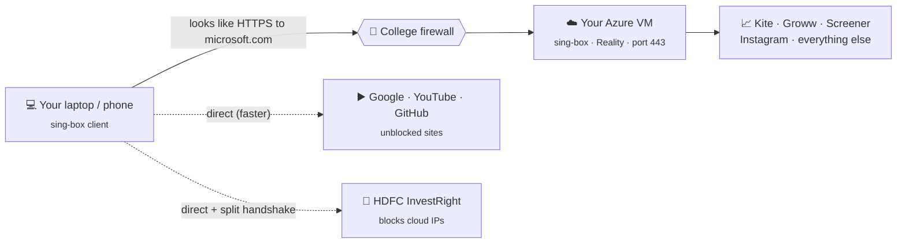

<div align="center">

# 🛰️ reality-tunnel

**Your own private tunnel on Azure, for Wi-Fi that blocks sites and VPNs.**

One script builds the server. Your laptop or phone connects in a minute.


[Quick start](#-quick-start) •
[Mac](#-mac) •
[Windows](#-windows) •
[Phone](#-android--iphone) •
[Routing](#-routing) •
[Cost](#-cost) •
[Troubleshooting](#-troubleshooting)

</div>

---

## ✨ Why this exists

College and office networks often block sites by reading the **site name in the HTTPS
handshake** (SNI filtering), allow only ports 80/443, and recognise commercial VPNs
(WARP, Proton, Nord) and block them too. This repo gives you a tunnel they can't tell
apart from normal web browsing.

| | |
|---|---|
| 🕵️ **Hard to detect** | VLESS + Reality on port 443. The firewall sees what looks like an ordinary visit to `www.microsoft.com`. |
| 📍 **Your own IP** | A static IP in the region you choose (for example India), used only by you. Good for brokers like Zerodha that check login IPs. |
| ⚡ **Split routing** | Unblocked heavy sites (Google, YouTube…) skip the tunnel. Sites that refuse cloud IPs go direct with a split handshake. |
| 🔒 **Locked down** | Only TCP 443 is open, with no SSH. Keys are generated **on your server** at first boot. |
| 💸 **Student-friendly** | Runs on Azure for Students credit. No credit card needed. |

> [!IMPORTANT]
> Running your own VPN is legal in India, but it may break your institution's IT
> acceptable-use policy. That's your call. Never share your link, and don't use this to
> harm anyone.

---

## 🧭 How it works



---

## 🚀 Quick start

> [!NOTE]
> This repo is **private**. Ask the owner to add your GitHub account
> (*Settings → Collaborators → Add people*) before you start.

**You need:** an Azure subscription
([Azure for Students](https://azure.microsoft.com/en-in/free/students/) works with your
college email and no card), plus a Mac, a Windows PC or a phone. It takes about 15 minutes.

### 1️⃣ Create the server (any OS, in the browser, ~5 min)

1. Open **[shell.azure.com](https://shell.azure.com)** and choose **Bash**. If asked, pick
   *No storage account required* and your subscription.
2. Sign in to GitHub and run the deploy script:
   ```bash
   gh auth login
   git clone https://github.com/prajwal-priyadarshan/reality-tunnel.git && cd reality-tunnel
   bash azure/deploy.sh
   ```
3. Check the **live prices** it shows and type `y`. It then:
   - ✅ checks which regions your subscription allows
   - ✅ creates a small Ubuntu 24.04 VM, trying sizes until one has capacity
   - ✅ opens **only port 443**
   - ✅ installs sing-box and generates fresh keys on the server
   - ✅ prints your **`vless://…` link**

> [!WARNING]
> **Copy the link right away.** It works like a password, and Cloud Shell sessions are
> temporary. To get it again later, run this in Cloud Shell:
> ```bash
> az vm run-command invoke -g reality-vpn-rg -n reality-vpn --command-id RunShellScript \
>   --scripts 'cat /root/vless_link.txt' --query 'value[0].message' -o tsv
> ```

<sub>Different region? `LOCATION=southindia bash azure/deploy.sh`.</sub>

### 2️⃣ Set up your device

| Device | Guide | Time |
|---|---|---|
| 🍎 Mac | [Mac setup](#-mac) | 3 min |
| 🪟 Windows 10/11 | [Windows setup](#-windows) | 5 min |
| 📱 Android / iPhone | [Phone setup](#-android--iphone) | 2 min |

### 3️⃣ Check it works

You should see **your server's region** as the exit IP, and `200` for the sites you care
about. Each guide includes its own test command.

---

## 🍎 Mac

```bash
brew install sing-box
git clone https://github.com/prajwal-priyadarshan/reality-tunnel.git && cd reality-tunnel
python3 client/make_client_config.py 'vless://…paste your link…'
```

This writes `client/out/` with your link and two configs. That folder is git-ignored.

**Connect.** Pick a mode:

| Mode | Command | Covers | Password? |
|---|---|---|---|
| Proxy | `bash client/connect.sh` | Browsers and most apps | No |
| Whole-Mac | `bash client/connect.sh tun` | **Every** app, even when Chrome ignores the proxy | Mac password |

Keep the window open and press **Ctrl+C** to disconnect.

**Test** in a second Terminal tab:
```bash
bash client/test.sh          # proxy mode
bash client/test.sh tun      # whole-Mac mode
```

<details>
<summary><b>Optional: check how your network blocks things first</b></summary>

Run this on the restricted Wi-Fi **without** the tunnel:
```bash
bash client/diagnose.sh
```
"handshake reset → SNI filter" with only ports 80/443 open is exactly what this tunnel
gets around. Sites that show **OK** can go in the `DIRECT` list for speed
(see [Routing](#-routing)).
</details>

<details>
<summary><b>Optional: stop the password prompt in whole-Mac mode</b></summary>

```bash
echo "$USER ALL=(root) NOPASSWD: $(command -v sing-box)" | sudo tee /etc/sudoers.d/sing-box && sudo chmod 440 /etc/sudoers.d/sing-box
```
This lets any program running as you start sing-box as root, which slightly weakens your
Mac's security. Undo it with `sudo rm /etc/sudoers.d/sing-box`.
</details>

---

## 🪟 Windows

> [!TIP]
> Want the quickest route? Skip to **[Option B](#option-b--app-only)**: install an app and
> paste your link.

### Option A · Full setup with all routing fixes (recommended)

**1. Install the tools** in **PowerShell** (Start → type *PowerShell*):
```powershell
winget install --id Git.Git -e
winget install --id Python.Python.3.12 -e
winget install --id SagerNet.sing-box -e
```
Close and reopen PowerShell afterwards, then check:
```powershell
sing-box version
python --version
```

<details>
<summary>winget can't find sing-box, or <code>python</code> opens the Microsoft Store?</summary>

- Download `sing-box-<version>-windows-amd64.zip` from
  [GitHub releases](https://github.com/SagerNet/sing-box/releases). Extract `sing-box.exe`
  into the `reality-tunnel` folder and use `.\sing-box.exe` instead of `sing-box`.
- Use `py` instead of `python`.
</details>

**2. Get the repo and make your configs:**
```powershell
cd $HOME\Documents
git clone https://github.com/prajwal-priyadarshan/reality-tunnel.git
cd reality-tunnel
python client\make_client_config.py 'vless://…paste your link…'
```
> [!CAUTION]
> Keep the link in **single quotes**. PowerShell treats `&` specially.

**3. Connect.** Pick a mode:

| Mode | Command | Notes |
|---|---|---|
| Proxy | `sing-box run -c client\out\config-proxy.json` | No admin needed. Windows' proxy turns on while it runs and off when you stop it |
| Whole-PC | `sing-box run -c client\out\config-tun.json` | Run PowerShell **as Administrator** (right-click → *Run as administrator*) |

If Windows Defender Firewall asks about `sing-box`, click **Allow**. Press **Ctrl+C** to
disconnect.

**4. Test** in a second PowerShell window (`curl.exe`, not `curl`):
```powershell
curl.exe -s -x http://127.0.0.1:2080 https://ipinfo.io/json
curl.exe -s -o NUL -w "%{http_code}`n" -x http://127.0.0.1:2080 https://kite.zerodha.com
```
<sub>In whole-PC mode, leave out `-x http://127.0.0.1:2080`.</sub>

### Option B · App only

Install **[Hiddify](https://github.com/hiddify/hiddify-app/releases)**
(`Windows-Setup-x64.exe`) or **v2rayN**. Copy your link, choose **Add from clipboard**,
then **Connect**.

> [!NOTE]
> The basic tunnel works, but without this repo's routing fixes: sites that block cloud
> IPs (like HDFC) may return 403, and pages can be slower because of QUIC.

---

## 📱 Android / iPhone

| | App | How |
|---|---|---|
| **Simplest** | **Hiddify** (Play Store / App Store) | Copy your `vless://` link → **Add from clipboard** → Connect |
| **All routing fixes** | Official **sing-box** app (App Store; *SFA* on Play Store / GitHub) | Send `client/out/config-tun.json` to the phone → **Profiles → New Profile → Import** |

> [!WARNING]
> `config-tun.json` contains your keys. Don't send it through chats or email you don't
> trust.

---

## 🔀 Routing

All routing rules live in **`client/make_client_config.py`**:

| List | Where traffic goes | Add a site when… |
|---|---|---|
| `DIRECT` | Straight out on ports 80/443, skipping the tunnel (fastest) | It loads fine on your network without the tunnel (`diagnose.sh` says **OK**) |
| `DIRECT_FRAGMENT` | Straight out, with the TLS handshake split so the firewall can't read the name | It returns **403 "Request blocked"** through the tunnel (it rejects cloud IPs) **and** is blocked on your network |
| *everything else* | Through your server | — |

After editing, regenerate the configs and restart the tunnel:
```bash
python3 client/make_client_config.py "$(cat client/out/vless_link.txt)"           # Mac
```
```powershell
python client\make_client_config.py (Get-Content client\out\vless_link.txt)        # Windows
```

<details>
<summary><b>Also built in</b></summary>

- **QUIC (UDP 443) is rejected**, so Chrome switches to TCP straight away instead of
  waiting on blocked UDP.
- **Whole-device mode uses MTU 1500 and the "mixed" stack.** macOS's default of 65535
  stalled parallel downloads.
- **Only web ports go direct.** Other ports (for example Google push on 5228) go through
  the tunnel, because restricted networks usually refuse them.
</details>

---

## 💸 Cost

`deploy.sh` shows **live Azure prices** before creating anything. Central India, Nov 2026:

| VM size | Per month (VM + static IP + 30 GB disk) |
|---|---|
| `Standard_B1s` | ~$4 if student free hours apply, otherwise ~$15. Often out of capacity |
| `Standard_B2ats_v2` | **~$11** |

The first 100 GB/month of data out is free. With student credit there's **no card on
file**, so you can't be billed beyond the credit.

| Action | How |
|---|---|
| ⏸️ Pause | Azure portal → Virtual machines → `reality-vpn` → **Stop**. The IP still costs ~$3.65/month |
| 🗑️ Delete everything | `bash azure/destroy.sh` in Cloud Shell. **This can't be undone** |

---

## 🛠️ Troubleshooting

<details>
<summary><b>Creating the server</b></summary>

| Symptom | Fix |
|---|---|
| "Region not allowed" | Use a region from the list it prints: `LOCATION=… bash azure/deploy.sh` |
| All sizes "not available" | Try another region, or `SIZES="Standard_B2s" bash azure/deploy.sh` |
| Setup didn't finish in time | Wait a few minutes, then fetch the link with the command in [Quick start](#-quick-start) |
</details>

<details>
<summary><b>Connecting</b></summary>

| Symptom | Fix |
|---|---|
| `ERR_CONNECTION_RESET` in Chrome (proxy mode) | Chrome is bypassing the system proxy. Use whole-device mode |
| Every site fails with `reality verification failed` | Client and server don't match. Regenerate the configs from your link |
| One site returns **403** through the tunnel | It blocks cloud IPs. Add it to `DIRECT_FRAGMENT` |
| A `DIRECT` site times out | Your network blocks it. Remove it from `DIRECT` |
| Slow in whole-device mode | Make sure your configs were generated by the current version (MTU 1500, QUIC blocked) |
</details>

<details>
<summary><b>No internet after a crash</b></summary>

The proxy setting can stay switched on if the tunnel crashes.

- **Mac:** System Settings → Network → Wi-Fi → Details → Proxies → turn everything off
- **Windows:** Settings → Network & internet → Proxy → *Use a proxy server* → Off
</details>

<details>
<summary><b>Windows-specific</b></summary>

| Symptom | Fix |
|---|---|
| `sing-box` not recognised | Reopen PowerShell after `winget install`, or use the downloaded `.\sing-box.exe` |
| "Access denied" / wintun error in whole-PC mode | Run PowerShell **as Administrator** |
</details>

---

## 📂 Repo layout

```
reality-tunnel/
├── azure/
│   ├── deploy.sh              # create the server (run in Cloud Shell)
│   └── destroy.sh             # delete everything
├── server/
│   └── cloud-init.sh          # first boot on the VM: sing-box + fresh keys
└── client/
    ├── make_client_config.py  # link → sing-box configs (routing rules live here)
    ├── connect.sh             # start the tunnel (proxy or tun)   · Mac/Linux
    ├── test.sh                # check exit IP and sites           · Mac/Linux
    └── diagnose.sh            # how your network blocks things    · Mac/Linux
```

<details>
<summary><b>Why sing-box on both ends?</b></summary>

The first version used Xray on the server. Xray 26.x and the sing-box 1.14 client failed
the Reality handshake ("reality verification failed") even with matching keys. Using
sing-box on both ends fixed it.
</details>
